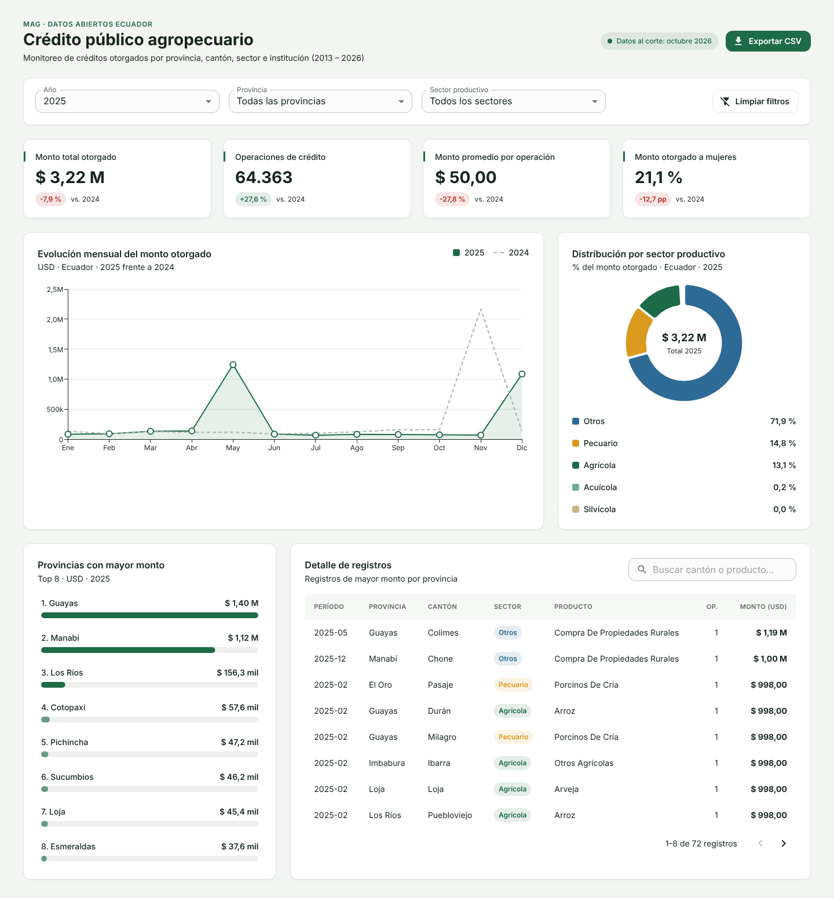
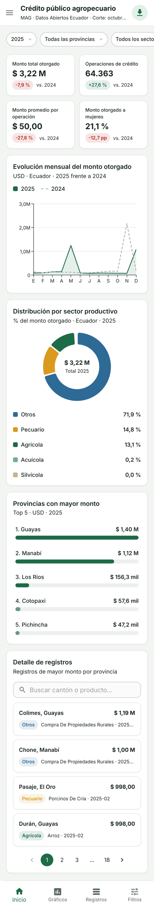

# Dashboard de Crédito Público Agropecuario

Proyecto de la materia **Desarrollo de Aplicaciones Web y Móviles (SOFG1006)** – ESPOL.
Integrantes: Mathias Giler e Ivan Alvarado.

Dashboard para monitorear el crédito público agropecuario otorgado en Ecuador por provincia, cantón, sector e institución, a partir de los datos abiertos del Ministerio de Agricultura y Ganadería (MAG).

## Sprint 1: Transformación de datos CSV a JSON

### Fuente de datos

| | |
|---|---|
| Dataset | Crédito público agropecuario por rubro, provincia y cantón desde el año 2013 (corte octubre 2026) |
| Publicado por | Ministerio de Agricultura y Ganadería (MAG) |
| Portal | https://www.datosabiertos.gob.ec/dataset/credito-publico-agropecuario-por-rubro-provincia-y-canton-desde-el-ano-2013-corte-octubre-2026 |
| Licencia | Creative Commons Attribution (CC-BY) |

### Estructura del repositorio

```
├── data/
│   ├── raw/
│   │   └── mag_creditopublicoagropecuario_2026octubre.csv(.zip)  # CSV original del MAG
│   └── processed/
│       ├── por_anio/
│       │   ├── credito_agropecuario_2013.json                    # un JSON por año
│       │   └── ...
│       ├── indice.json                                           # lista de archivos y registros por año
│       ├── muestra_credito_agropecuario.json                     # primeros 5 registros con formato legible
│       └── reporte_validacion.json                               # resultados de la limpieza y validación
├── scripts/
│   ├── transformar_csv_json.py                              # script de transformación
│   └── generar_resumenes.py                                 # resúmenes para Firebase (Sprint 3)
│   └── firebase/
│       └── resumenes.json                                    # totales por año y provincia para Firebase
├── firebase/
│   ├── database.rules.json                                   # reglas de Realtime Database
│   └── estructura_inicial.json                               # nodos vacíos para importar los datos
├── dashboard/                                               # aplicación React (Sprint 2)
└── README.md
```

### Requisitos

- Python 3.9 o superior. No necesita librerías externas (solo usa la biblioteca estándar).

### Cómo ejecutar

1. Descargar el CSV desde el portal de Datos Abiertos y guardarlo en `data/raw/` con el nombre `mag_creditopublicoagropecuario_2026octubre.csv`. Como el archivo original pesa más de lo que GitHub permite (100 MB por archivo), en el repositorio se guarda comprimido como `mag_creditopublicoagropecuario_2026octubre.csv.zip`; el script lee directamente el `.zip`, no hace falta descomprimirlo.
2. Desde la raíz del repositorio, ejecutar:

   ```bash
   python scripts/transformar_csv_json.py
   ```

   Si el CSV tiene otro nombre:

   ```bash
   python scripts/transformar_csv_json.py --entrada data/raw/archivo.csv
   ```

3. El script muestra un resumen en la consola y genera los archivos de `data/processed/`. Si la validación encuentra errores, termina con código 1.

> **¿Por qué un JSON por año?** El JSON completo supera los 100 MB que GitHub acepta por archivo. Dividirlo por año mantiene cada archivo pequeño y además facilita cargar los datos a Firebase por partes en el siguiente sprint. `indice.json` indica qué archivos existen y cuántos registros tiene cada uno.

### Qué hace el script

1. **Lectura:** detecta la codificación (UTF-8 o Latin-1) y el separador (`;`, `,` o tabulación) y descarta las filas completamente vacías.
2. **Espacios en blanco:** quita espacios al inicio y al final y reduce los espacios repetidos dentro del texto.
3. **Conversión de tipos:**

   | Columna CSV | Campo JSON | Tipo en JSON |
   |---|---|---|
   | CP_ANIO | `anio` | number (entero) |
   | CP_MES | `mes` | number (1–12); acepta número o nombre del mes |
   | — | `periodo` | string `AAAA-MM` |
   | — | `fecha` | string ISO 8601 `AAAA-MM-01` |
   | DPA_PROVIN | `codProvincia` | string de 2 dígitos (`"09"`) |
   | DPA_DESPRO | `provincia` | string |
   | DPA_DESCAN | `canton` | string |
   | CP_SECTOR | `sector` | string |
   | CP_SUBSECTOR | `subsector` | string |
   | CP_PRODUCTO_ORIGINAL | `productoOriginal` | string |
   | CP_PRODUCTO_HOMOLOGADO | `producto` | string |
   | CP_GENERO | `genero` | string |
   | CP_INSTITUCION | `institucion` | string |
   | CP_VALOR_USD | `valorUsd` | number (2 decimales); acepta `1234,5` o `1.234,50` |
   | CP_NUM_OPERACIONES | `numOperaciones` | number (entero) |

   Además se agrega un `id` único (`R000001`, `R000002`, …) que servirá como clave al cargar los datos en Firebase.

4. **Valores faltantes o inconsistentes:**
   - Variable categórica vacía (`""`, `NA`, `N/A`, `NULL`, `-`): se reemplaza por `"NO REGISTRADO"`.
   - `numOperaciones` vacío: queda como `null` y el registro se conserva.
   - Año, mes o monto vacíos o no válidos (por ejemplo, mes 13): el registro se descarta.
   - Montos u operaciones negativos: el registro se descarta.
   - Categorías escritas de distinta forma (`Guayas` / `GUAYAS`): se unifican a la forma más frecuente.
   - Se cuentan los registros duplicados exactos para revisarlos.
5. **Validación del JSON:** se vuelven a leer los archivos generados y se comprueba que la raíz de cada uno sea un arreglo, que cada archivo solo tenga registros de su año y coincida con `indice.json`, que cada registro tenga los 16 campos con el tipo correcto, que la fecha cumpla el formato `AAAA-MM-01`, que no queden textos con espacios sobrantes, que los `id` no se repitan y que la cantidad de registros sea igual a *registros del CSV − registros descartados*.

### Ejemplo de registro

```json
{
  "id": "R000001",
  "fecha": "2025-01-01",
  "periodo": "2025-01",
  "anio": 2025,
  "mes": 1,
  "codProvincia": "09",
  "provincia": "GUAYAS",
  "canton": "DAULE",
  "sector": "AGRÍCOLA",
  "subsector": "CEREALES",
  "productoOriginal": "ARROZ PILADO",
  "producto": "ARROZ",
  "genero": "M",
  "institucion": "BANECUADOR",
  "valorUsd": 9842150.35,
  "numOperaciones": 1284
}
```

Los valores reales de cada ejecución están en `data/processed/muestra_credito_agropecuario.json` y `data/processed/reporte_validacion.json`.

## Sprint 2: Componentes e interfaces React

La interfaz del dashboard está en la carpeta [`dashboard/`](dashboard). Se creó con Vite, React y TypeScript, y usa Material UI para los componentes y el diseño responsivo.

```bash
cd dashboard
npm install
npm run dev
```

Los componentes siguen el árbol definido en la fase de planificación: `DashboardPage` guarda el estado con `useState` (filtros, búsqueda, página y sección activa) y envía los datos por props a `Header`, `FilterBar`, `KpiGrid`, los gráficos y la tabla. Por ahora se usan datos de ejemplo sacados de los JSON del Sprint 1; en el siguiente sprint se leerán desde Firebase.

Más detalles en [`dashboard/README.md`](dashboard/README.md).

| Escritorio | Móvil |
|---|---|
|  |  |

## Sprint 3: Conexión de React con Firebase

Los datos se almacenan en **Firebase Realtime Database** y la aplicación React los consulta con el SDK de Firebase.

### Estructura de la base de datos

```
/
├── registros/
│   ├── 2013/   ← data/processed/por_anio/credito_agropecuario_2013.json
│   ├── ...
│   └── 2026/   ← data/processed/por_anio/credito_agropecuario_2026.json
└── resumenes/  ← data/firebase/resumenes.json
    ├── catalogos/   (años, provincias y sectores para los filtros)
    └── porAnio/{año}/{provincia | "Todas"}/   (monto, operaciones, montoMujeres, mensual[12], sectores)
```

Los 298 865 registros pesan unos 100 MB, así que la aplicación no los descarga completos: los KPI y gráficos salen de `/resumenes` (≈150 KB) y la tabla consulta solo los registros que necesita.

### Cómo cargar los datos

1. Generar los resúmenes: `python scripts/generar_resumenes.py`.
2. En la consola de Firebase (Realtime Database → Datos), importar primero `firebase/estructura_inicial.json` en la raíz: crea los nodos vacíos `/registros/2013` … `/registros/2026` y `/resumenes`.
3. Entrar a cada nodo e importar ahí su archivo: `credito_agropecuario_AAAA.json` en `/registros/AAAA` y `resumenes.json` en `/resumenes`. Después del paso 2 no se vuelve a importar en la raíz: la importación reemplaza todo lo que hay en esa ruta.
4. Copiar el contenido de `firebase/database.rules.json` en la pestaña **Reglas** y publicar. Las reglas permiten solo lectura de `registros` y `resumenes` y crean los índices `valorUsd` y `provincia`.

La configuración de React con Firebase y los hooks con `useEffect` y `useState` se explican en [`dashboard/README.md`](dashboard/README.md#datos-desde-firebase).
